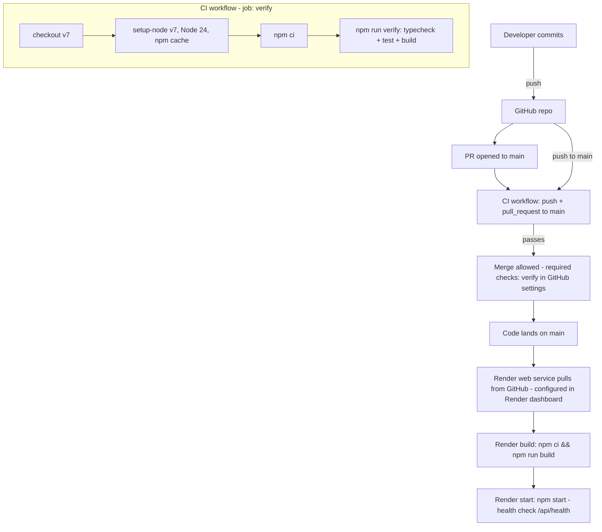

# CI/CD Overview — `cicd-lab-starter`

> Reverse-engineered from repository evidence on 2026-10-13. Read-only investigation:
> no files were modified, no workflows were run, and no conclusions are based on
> observed execution — configuration only. Items that cannot be seen from inside
> the repo are marked **verify in GitHub settings** / **verify on Render**.

## 1. Executive summary

This is a deliberately minimal teaching repo (a "CI/CD Crash Course" starter:
Express 5 + TypeScript on Node 24). The entire pipeline is a **single GitHub
Actions workflow** (`.github/workflows/ci.yml`) that runs one job — `npm ci` →
`npm run verify` (typecheck + test + build) — on pushes and PRs to `main`.
**There is no automated CD**: deployment to Render is documented in the README
as a manually configured web service that pulls from the repo itself, not
something the pipeline pushes. There are no Docker, release, lint, security, or
git-hook tooling anywhere. Maturity: **early / educational** — CI fundamentals
are solid and modern (lockfile install, caching, scoped permissions, timeouts);
everything else is intentionally absent.

## 2. Inventory of files found

| Category | Files found |
|---|---|
| GitHub Actions workflows | `.github/workflows/ci.yml` |
| Reusable workflows / composite actions | None (`.github/actions/` does not exist) |
| Dependabot / CODEOWNERS / PR & issue templates | None |
| Other CI systems (GitLab, Jenkins, CircleCI, Azure, Bitbucket) | None |
| Docker (`Dockerfile`, `.dockerignore`, compose) | None |
| Deployment configs (vercel/netlify/fly/railway/render.yaml/Procfile/app.yaml/serverless/terraform/k8s/PM2/systemd/deploy scripts) | None — Render deployment is configured **in the Render dashboard** (per `README.md:47–53`); no `render.yaml` blueprint in the repo |
| Release tooling (semantic-release, changesets, release-please, CHANGELOG, tags) | None — no CHANGELOG, no git tags |
| Git hooks (husky, lint-staged, commitlint, lefthook) | None |
| Environment files | `.env.example` (committed, placeholder values only). `.gitignore` correctly excludes `.env` / `.env*` (`.gitignore:3–5`); no `.env` exists on disk |
| Lock file | `package-lock.json` (npm) |

## 3. Project foundations

| Aspect | Finding | Evidence |
|---|---|---|
| Node version | **24.x** — pinned only in `engines` and the workflow's `setup-node` input. No `.nvmrc`/`.node-version`. No Dockerfile, so no image-level pin | `package.json:6–8`, `.github/workflows/ci.yml:27` |
| Package manager | **npm** (no `packageManager` field, no Corepack config; implied by `package-lock.json` and `npm ci` usage) | `package.json`, `ci.yml:31` |
| Monorepo / workspaces | No — single package, no `workspaces` field | `package.json` |
| Module system | **ESM** (`"type": "module"`), imports use `.js` extensions for NodeNext resolution | `package.json:20`, `src/server.ts:1` |
| TypeScript | Single `tsconfig.json`: `strict: true`, `module/moduleResolution: NodeNext`, `target: ES2022`, `rootDir: src` → `outDir: dist`, `noEmitOnError`, `noUnusedLocals/Parameters`. No path aliases. Executed via **tsx** in dev/test, **tsc** for build | `tsconfig.json`, `package.json:10,12,13` |
| Framework / entry point | Express 5. `src/app.ts` exports the app (home page + `GET /api/health`); `src/server.ts` is the listening entry | `src/app.ts`, `src/server.ts` |
| Tests | Node's built-in test runner (`node:test`) with tsx loader. One **integration-style** test (`test/app.test.ts`) that boots the app on an ephemeral port and asserts `GET /api/health` → 200 `{"status":"ok"}`. No unit/e2e split, no external deps needed | `package.json:12`, `test/app.test.ts:34–41` |
| Lint / format | **None** — no ESLint, Prettier, or Biome configs anywhere | — |
| ORM / migrations | **None** | — |
| External services | **None** — no database, Redis, or third-party APIs in `dependencies` (only `express`) | `package.json:21–23` |

### `package.json` scripts and who calls them

| Script | What it does | Called by CI/deploy? |
|---|---|---|
| `dev` | tsx watch with `--env-file=.env` for local dev | No (local only) |
| `typecheck` | `tsc --noEmit` | Yes — via `verify` |
| `test` | Node test runner + tsx, runs `test/app.test.ts` | Yes — via `verify` |
| `build` | `tsc` → `dist/` | Yes — via `verify`, and on Render via build command |
| `start` | `node --env-file-if-exists=.env dist/server.js` (loads `.env` only if present, so the same command works locally and on Render) | Yes — Render start command (`README.md:50`) |
| `verify` | `typecheck && test && build` — the composite CI gate | Yes — `ci.yml:34` |

## 4. Workflow-by-workflow breakdown — `.github/workflows/ci.yml`

Only one workflow exists. **Name:** `CI` (ci.yml:1). **Purpose:** verify that
pushes and PRs targeting `main` typecheck, test, and build.

| Aspect | Value | Line |
|---|---|---|
| Triggers | `push` to `main`; `pull_request` to `main`. No path filters, no schedule, no `workflow_dispatch`, no `workflow_call` | 3–9 |
| Permissions | Workflow-level `contents: read` (least privilege; no job-level overrides) | 11–12 |
| Concurrency | **Not configured** (no `concurrency:` block — concurrent runs of the same ref are not cancelled) | — |
| Env vars / secrets | **None referenced at all** — no `env:`, no `secrets:`, no `vars:` | — |
| Caching | npm cache via `actions/setup-node` `cache: npm` (caches `~/.npm`, keyed on `package-lock.json`) | 28 |
| Artifacts | None uploaded/downloaded; `dist/` is rebuilt each time and discarded | — |
| Services / matrix / environment | None | — |

**Single job `verify`** (`runs-on: ubuntu-latest`, `timeout-minutes: 10`, no
`needs`/`if` conditions):

| # | Step | Action / command (pin style) | Purpose |
|---|---|---|---|
| 1 | Check out repository | `actions/checkout@v7` — **pinned by major tag** | Fetch source |
| 2 | Set up Node.js | `actions/setup-node@v7` with `node-version: 24`, `cache: npm` — **pinned by major tag** | Node 24 + npm cache |
| 3 | Install dependencies | `npm ci` | Deterministic lockfile install |
| 4 | Verify application | `npm run verify` | Typecheck → test → build |

**Third-party actions:** `actions/checkout` and `actions/setup-node` (both
first-party GitHub actions), each pinned **by major tag, not SHA**. No
third-party (non-`actions/`) actions in use.

## 5. Flow diagram

Note: the CI workflow itself has **no deploy job**; the Render arrow is the
documented manual/dashboard path (`README.md:47–53`), not a workflow.

## 6. CI vs CD vs release classification

| Capability | Status |
|---|---|
| CI: install (`npm ci`) | ✅ Exists (`ci.yml:31`) |
| CI: typecheck | ✅ Exists (via `verify`) |
| CI: tests | ✅ Exists (one test, via `verify`) |
| CI: build | ✅ Exists (via `verify`) |
| CI: lint / format check | ❌ Absent (no tooling in repo) |
| CI: security audit / dependency scanning | ❌ Absent (no `npm audit`, no Dependabot) |
| CD: artifact/image build & push | ❌ Absent — no Docker, no registry |
| CD: automated deploy step | ❌ Absent — no deploy job, no SSH/PaaS CLI/kubectl |
| CD: deployment target | Render web service, configured **in the Render dashboard** (implied target; repo evidence is `README.md:47–53`). No `render.yaml`, so settings are not version-controlled |
| CD: environments, approvals, migrations, rollback | ❌ Absent / not in repo. Migrations N/A (no DB). Health checks: Render-side (`/api/health` per `README.md:51`) |
| Release management: versioning, tagging, changelog, npm/GH publishing | ❌ Absent entirely — no tags, no CHANGELOG, no publish step |

**Bottom line: this project is CI-only, plus externally-managed Git-pull
deployment on Render.**

## 7. Commit-to-production journey

1. Developer commits locally → **manual** (no local hooks to run anything)
2. Pushes branch (e.g. `origin/feat/hello` exists) → **automated** push, but CI does *not* run on non-`main` branches (no `push` trigger for feature branches — `ci.yml:4–6`)
3. PR opened against `main` → CI runs typecheck/test/build → **automated**
4. Merge to `main` → CI runs again (push trigger) → **automated**; merge gating depends on required status checks — **verify in GitHub settings** (not visible in repo)
5. Build + run on Render → **automated by Render** once the web service exists (Git auto-deploy), but the Render service itself was set up **manually** (`README.md:47–53`). Whether auto-deploy is enabled, and whether deploys are blocked on CI, is **not determinable from the repository**

## 8. Git history evidence

All six commits are dated 2026-10-08 (single day; teaching-lab timeline):

- `4f037b9` "first commit" → app + scripts; CI added separately in `add2f48` — the only commit ever to touch `.github/`
- `bfae05e` "Comment out health check endpoint" then `f69fb88` "Restore health check endpoint" — a deliberately broken-then-fixed commit pair (course exercise: watch CI fail, then fix). The endpoint was restored *before* PR #1 merged
- PRs #1 and #2 both named `feat/version-endpoint` (PR #2's branch content actually delivered the merge; the branch name was reused). **Merge commits, not squash** — history preserves individual commits
- Branching: single long-lived `main` + short-lived `feat/*` branches (e.g. `origin/feat/hello`, currently ahead of main locally). No `develop`/release branches, no tags
- No commit messages record *why* pipeline decisions were made beyond the one-liners above

## 9. Secrets and configuration (names only)

| Name | Where referenced | Purpose | Scope |
|---|---|---|---|
| `PORT` | `src/server.ts:3`, `.env.example:2`, `README.md:53` | Listen port (Render injects it) | Runtime |
| `APP_VERSION` | `src/app.ts:6`, `.env.example:3`, `README.md:53` | Displayed on home page; set manually in Render dashboard | Runtime |
| GitHub secrets / `vars` | **None referenced** by any workflow | — | — |

Committed secrets: **none found.** `.gitignore:3–5` excludes `.env`/`.env*`
except `.env.example`; `.env.example` contains only placeholder values. No
remediation needed.

## 10. Assessment

### Working well (worth copying)

- Least-privilege workflow: `permissions: contents: read` (ci.yml:11–12)
- Lockfile installs via `npm ci` in both CI and the Render build command
- A single composite `verify` script keeps local and CI gates identical (`package.json:15`)
- `cache: npm` on setup-node and a job `timeout-minutes: 10`
- No secrets in CI at all → nothing can leak to forked PRs; `pull_request` (not `pull_request_target`) used, so fork PRs get no write access
- Tests are hermetic (ephemeral port, no live services — `test/app.test.ts:11`)
- Clean `.env` hygiene with a committed example

### Gaps and risks (confirmed findings)

- No lint/format or security audit stage; no Dependabot
- **CI doesn't run on feature-branch pushes** (`ci.yml:4–6`) — only on PRs to `main`; pushes directly to feature branches are unverified until a PR is opened
- No `concurrency` group → redundant runs and a possible race between a PR check and its post-merge push run
- Actions pinned by major tag (`@v7`), not commit SHA — tag-repointing risk (low here; both are first-party GitHub actions)
- Node pinned as loose ranges (`engines: 24.x`, workflow `node-version: 24` resolves to latest 24.x) — no exact version pin anywhere; minor drift possible between local and CI over time
- `README.md:43` says `verify` is "typecheck and build in one step" but it actually runs typecheck + **test** + build — a docs/behavior mismatch
- Deploy settings (Render service, auto-deploy toggle, `APP_VERSION`) live outside the repo — no infrastructure-as-code
- No rollback mechanism documented or automated (Render supports rollbacks; that's platform-side)

### Must verify outside the repo

- **GitHub settings:** branch protection on `main` with required status check `Verify`, no direct pushes; Actions enabled
- **Render:** whether the web service exists, auto-deploy is on, and `APP_VERSION` is configured
- **Execution status:** whether CI runs are actually green — not verifiable from the repo (this document describes configuration, not results)

## 11. Reusable blueprint — replicating this in another Node + TS project

1. **Copy `.github/workflows/ci.yml`** — adjust `node-version` to your target; consider adding `concurrency` and a `push` trigger for feature branches; pin actions by SHA for stricter supply-chain posture
2. **Copy the `verify` script pattern** into `package.json` (`typecheck && test && build`) plus `typecheck`/`build`/`test`/`start` scripts — CI calls only `npm ci` and `npm run verify`
3. **Copy `.gitignore`** (ensures `.env` exclusion) and commit an `.env.example`
4. **tsconfig:** `NodeNext` + `strict`, `rootDir`/`outDir`, `noEmitOnError`; use `"type": "module"` and `.js` import extensions if going ESM
5. **Secrets/vars to create in the new repo:** none are required to replicate this pipeline as-is; add only when a deploy stage is introduced
6. **Manual setup:** enable GitHub Actions; set branch protection with `Verify` as a required check; on the host (e.g. Render): create service with build `npm ci && npm run build`, start `npm start`, health-check path, and runtime env vars — or, better than the current repo, codify the host config (`render.yaml` etc.) so it's version-controlled

## 12. Open questions

1. Is branch protection active on `main` with `Verify` as a required check?
2. Is the Render web service created, is auto-deploy enabled, and is `APP_VERSION` set in its dashboard?
3. Is this repo the course "starter" to keep as-is, or is the real target a fork where CD will be added?
4. Should feature-branch pushes run CI, or is PR-only intentional for the course?
